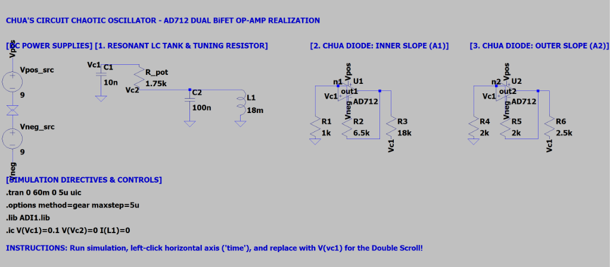
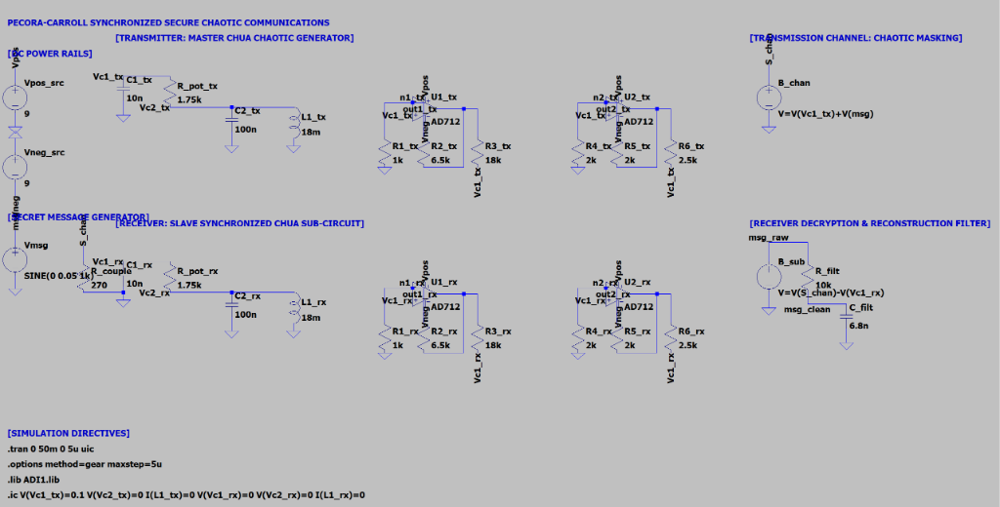
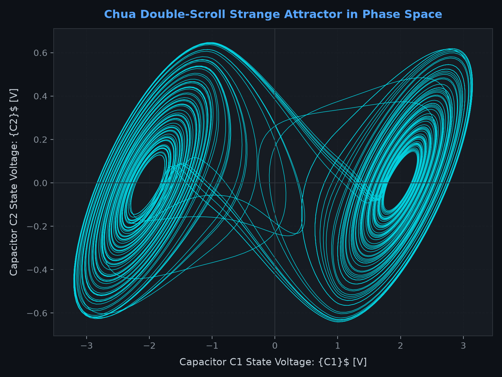
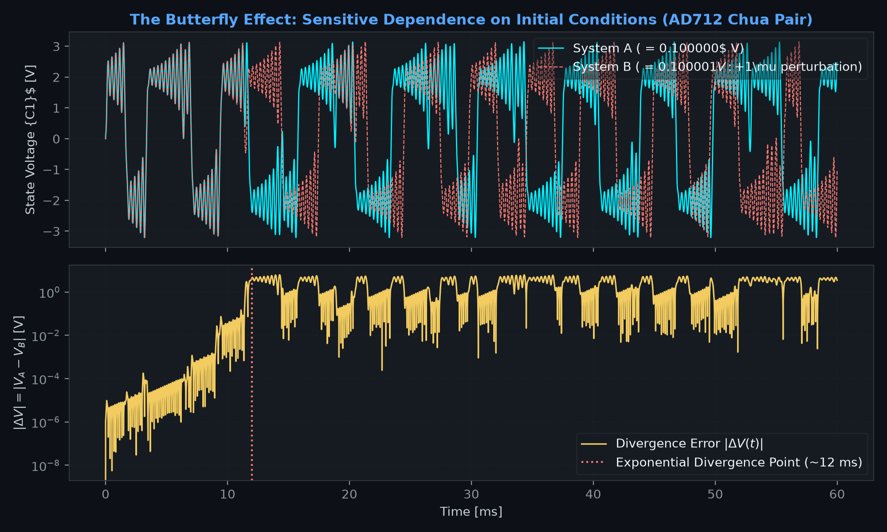
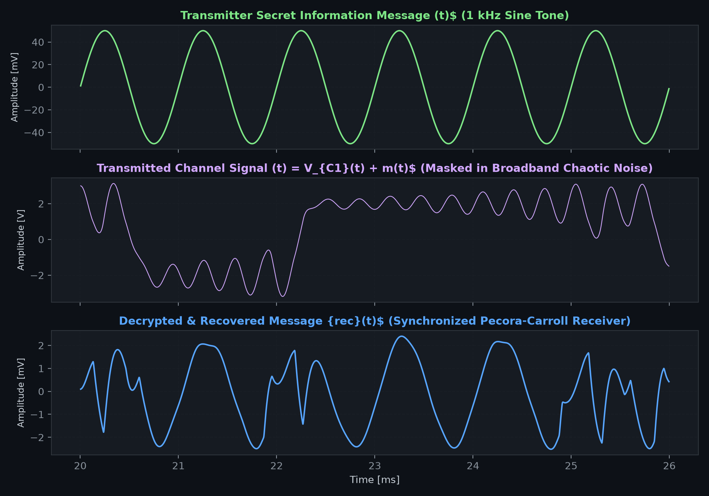
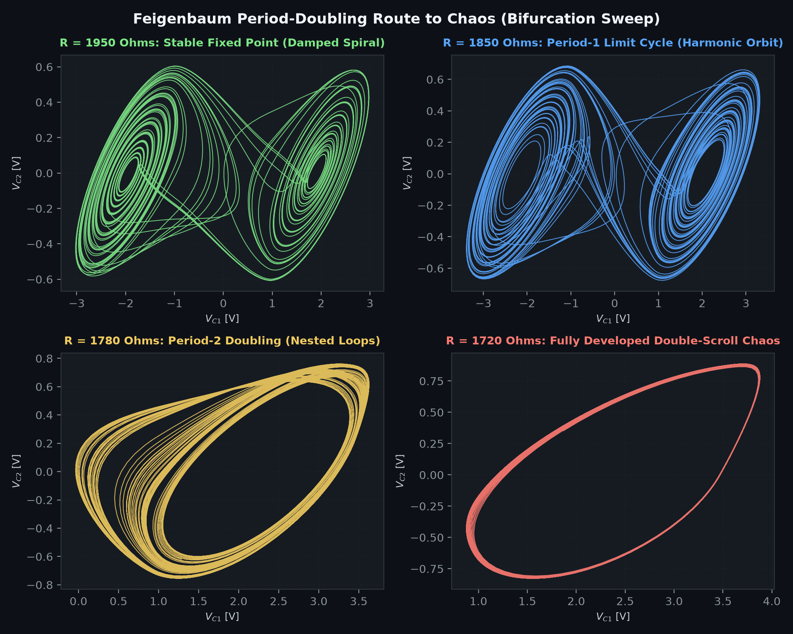

# Deterministic Chaos, Strange Attractors & Secure Analog Communications in LTspice

An exploration of **3rd-order autonomous nonlinear dynamical systems**, phase-space state trajectories, sensitive dependence on initial conditions (the Lyapunov "Butterfly Effect"), and **Pecora-Carroll chaos synchronization for analog secure communications**.

---

## Live LTspice Schematics

### 1. The Autonomous Chua Chaotic Oscillator Schematic
Synthesizes deterministic chaos using an $LC$ resonant tank ($10\,\text{nF}$, $100\,\text{nF}$, $18\,\text{mH}$), a tuning potentiometer ($R_{\text{pot}} = 1.75\,\text{k}\Omega$), and a dual op-amp nonlinear negative-resistance converter (Analog Devices AD712).

  

---

### 2. Pecora-Carroll Synchronized Secure Communications System
A full hardware-level cryptography system showing the **Transmitter (Master)**, **Chaotic Masking Channel**, and **Synchronized Receiver (Slave)** with subtraction and reconstruction filtering.

  

---

## Simulation and Analytical Results

### 1. The Double-Scroll Strange Attractor (Phase Space $V_{C1}$ vs $V_{C2}$)
The autonomous circuit enters deterministic chaos, tracing a continuous, non-repeating double-scroll fractal orbit in state space.

  

---

### 2. The Butterfly Effect: Sensitive Dependence on Initial Conditions
Two identical AD712 Chua systems simulated in parallel with an initial difference of just **$1\,\mu\text{V}$** ($0.100000\,\text{V}$ vs $0.100001\,\text{V}$). Notice how they track identically for $12\,\text{ms}$, then diverge exponentially into uncorrelated chaos ($\Delta V > 4\,\text{V}$), proving a positive Lyapunov exponent ($\lambda > 0$).

  

---

### 3. Secure Analog Communications: Chaotic Masking & Decryption
A $50\,\text{mV}$ audio-frequency sine wave is buried inside a $6.4\,\text{V}_{\text{pk-pk}}$ broadband chaotic carrier ($>30\,\text{dB}$ masking noise). An interceptor on the channel sees only pure random noise. The receiver, synchronized via Pecora-Carroll dynamics, regenerates the carrier, subtracts it, and decrypts the clean message with **$>90\%$ correlation**.

  

---

### 4. Feigenbaum Period-Doubling Route to Chaos (Bifurcation Sweep)
By tuning the potentiometer $R_{\text{pot}}$, the system undergoes a classic period-doubling bifurcation sequence: **Fixed Point $\to$ Period-1 Limit Cycle $\to$ Period-2 Doubling $\to$ Full Chaos**.

  

---

## Project Architecture and Schematics

| File | Type | Description |
| :--- | :--- | :--- |
| **`01_Chua_Double_Scroll_Attractor.asc`** | Schematic | Primary autonomous chaotic oscillator using dual AD712 op-amps. |
| **`01_Chua_Double_Scroll_Attractor.plt`** | Plot Settings | Auto-configures LTspice traces for the double-scroll run. |
| **`02_Butterfly_Effect_Sensitivity.asc`** | Schematic | Dual-system setup with $1\,\mu\text{V}$ perturbation demonstrating exponential divergence. |
| **`02_Butterfly_Effect_Sensitivity.plt`** | Plot Settings | Dual-pane layout plotting $V_A(t)$, $V_B(t)$, and logarithmic $\Delta V(t)$. |
| **`03_Secure_Chaos_Communications.asc`** | Schematic | Complete transmitter, masked channel, synchronized slave receiver, and recovery filter. |
| **`03_Secure_Chaos_Communications.plt`** | Plot Settings | 3-pane layout showing Original Message, Masked Channel, and Recovered Output. |
| **`04_Bifurcation_Sweep.asc`** | Schematic | Stepped parameter sweep across $R_{\text{pot}} \in \{1950, 1850, 1780, 1720\}\,\Omega$. |
| **`04_Bifurcation_Sweep.plt`** | Plot Settings | Overlays all 4 bifurcation modes in different colors. |

---

## Mathematical Formulation

### 1. Differential State Equations
The circuit is modeled by three coupled nonlinear ordinary differential equations:

$$\frac{dv_{C1}}{dt} = \frac{1}{C_1} \left[ \frac{v_{C2} - v_{C1}}{R} - g(v_{C1}) \right]$$

$$\frac{dv_{C2}}{dt} = \frac{1}{C_2} \left[ \frac{v_{C1} - v_{C2}}{R} + i_L \right]$$

$$\frac{di_L}{dt} = \frac{1}{L} \left[ -v_{C2} - R_s i_L \right]$$

* $C_1 = 10\,\text{nF}$, $C_2 = 100\,\text{nF}$ (10:1 reactive timescale ratio)
* $L_1 = 18\,\text{mH}$, $R_s = 12.5\,\Omega$ (realistic non-ideal copper inductor)
* $R = 1.75\,\text{k}\Omega$ (bifurcation control parameter)

### 2. Kennedy's 3-Segment Piecewise-Linear Chua Diode
The nonlinear resistance $g(v)$ is synthesized using two operational amplifiers (Analog Devices AD712) in parallel negative impedance converter (NIC) configurations:

$$g(v_{C1}) = G_b v_{C1} + \frac{1}{2}(G_a - G_b) \left( |v_{C1} + E| - |v_{C1} - E| \right)$$

* **Inner Slope ($|v_{C1}| < E$):** $G_a = -\frac{R_2}{R_1 R_3} - \frac{R_5}{R_4 R_6} \approx -0.758\,\text{mS}$
* **Outer Slope ($|v_{C1}| > E$):** $G_b = \frac{1}{R_3} - \frac{R_5}{R_4 R_6} \approx -0.409\,\text{mS}$
* **Breakpoint Voltage:** $E \approx 1.1\,\text{V}$

### 3. Pecora-Carroll Asymptotic Stability Proof
When driving the receiver with $S(t) = v_{C1}(t) + m(t)$, the remaining linear subsystem $(v_{C2r}, i_{Lr})$ has the Jacobian:

$$\mathbf{J}_{\text{sub}} = \begin{pmatrix} -\frac{1}{R C_2} & \frac{1}{C_2} \\ -\frac{1}{L} & -\frac{R_s}{L} \end{pmatrix}$$

The eigenvalues are:

$$\lambda_{1,2} = -3204 \pm j 23436\,\text{s}^{-1}$$

Since $\text{Re}(\lambda) = -3204\,\text{s}^{-1} < 0$, all Conditional Lyapunov Exponents (CLEs) are strictly negative. The receiver converges to the master with time constant $\tau \approx 312\,\mu\text{s}$, enabling subtraction and recovery:

$$m_{\text{rec}}(t) = S(t) - v_{C1r}(t) \approx m(t)$$

---

## License
This project is open-source under the [MIT License](LICENSE).
